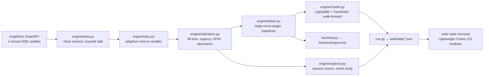

# VolumeLens

**An urgency terminal for NSE stocks.** A time chart gives every five minutes the same space,
whether ten people traded or ten thousand. VolumeLens draws a new candle every time a fixed
number of shares trade, so a burst of urgent volume becomes dozens of candles instead of one.

*Volume-Normalized Market Representation for Quantitative Detection of Price–Flow Anomalies*
Team 53 · Hindustan Institute of Technology & Science


**What the evidence says** (walk-forward, 20 unseen sessions, [model card](docs/MODEL_CARD.md)):
after an urgent candle, a large move followed **19.9%** of the time versus **8.6%** after all other
candles (**2.3×**, **3.5×** outside the opening hour, stable at 2.2–2.4× across thresholds).
The alert model beats VPIN by +0.12 AUC (95% CI +0.03 to +0.22). Urgency does not predict direction.

## The terminal

| | |
|---|---|
| **Volume candles** | One candle per fixed number of shares, sized per stock from its previous 20 sessions. Amber candles are urgent: the last 3 filled in under 40% of their normal time. |
| **Fill-time strip** | How long each candle took to fill, the normal fill time for that moment, and VPIN. |
| **Compare chart** | A normal 1/3/5/15/30-minute chart for comparison, built in the browser from 1-minute data, with urgent minutes shaded. |
| **Unfold** | Click a time candle: the main chart glides to the volume candles that formed inside it ("the 5-minute candle 15:05–15:10 unfolds into 22 volume candles, 22 urgent"). |
| **Replay** | Plays a session at market pace, so bursts rush in. Only what was known at each moment is shown; this is verified by tests. |
| **Tools** | Horizontal line (on both charts), trend line, zone, measure (Δ price, %, candles, shares, minutes), magnet crosshair, undo, snapshot to PNG, fullscreen. Drawings are saved per stock. |
| **Scanner and alerts** | Stocks ranked by urgency score, the most urgent sessions, and model alerts with TreeSHAP reasons. |
| **Layers** | Compare chart, urgency shading, VPIN and an absorption pane, each on or off. |

Keys: `V` cursor · `H` line · `T` trend · `Z` zone · `M` measure · `G` magnet · `Ctrl+Z` undo ·
`S` snapshot · `F` fullscreen · `R` replay · `Space` play · `←` `→` step · `Esc` back · `?` help.

## Architecture



The website is static: all computation runs offline in `run.py`, so hosting needs no server.

```
engine/        data loading, volume candles, indicators, labels, model, urgency statistics
web/           the terminal (index.html, css/, js/ modules, fonts/, vendor/, data/)
tests/         engine tests (pytest) and browser tests (tests/e2e, Playwright)
backtest.py    full validation → backtest/report.md, backtest/results.json
docs/          model card, test report, screenshots
```

## Run it

```bash
python -m venv .venv
.venv/Scripts/pip install -r requirements.txt        # Windows; .venv/bin on macOS/Linux
.venv/Scripts/python run.py                          # build web/data from data/*.csv
.venv/Scripts/python -m http.server 8765 --directory web
```

Open <http://localhost:8765>. Input is one CSV per stock in `data/`:
`timestamp,open,high,low,close,volume` (1-minute NSE candles).

## Verify it

```bash
.venv/Scripts/python -m pytest -q      # 11 engine tests, including no-repaint guarantees
npm install && npx playwright test     # 26 browser checks in Edge and Chrome
.venv/Scripts/python backtest.py       # walk-forward validation with bootstrap intervals
```

See the [test report](docs/TEST_REPORT.md) for what each check guarantees and the issues it caught.

## Limits

6 stocks, about 30 sessions, 1-minute data (no order book). Urgency says a large move is more
likely, not which way. The alert model ties a simple recent-volatility signal on this sample. Details
and next steps are in the [model card](docs/MODEL_CARD.md).

## Deploy

`vercel.json` serves `web/` as a static site with security headers; connect the folder or
repository in Vercel, no build step.

## License

Apache License 2.0. See [LICENSE](LICENSE) and [NOTICE](NOTICE) (TradingView Lightweight Charts™,
IBM Plex Sans, JetBrains Mono). Educational project, not investment advice.
