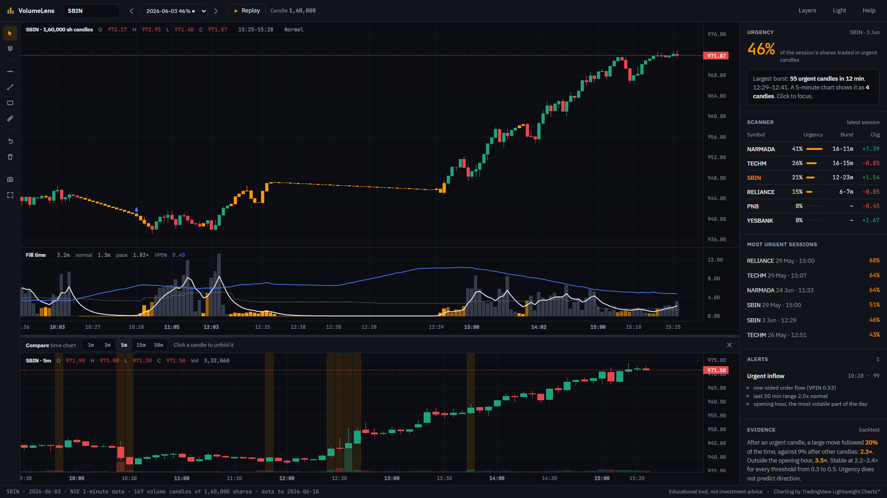
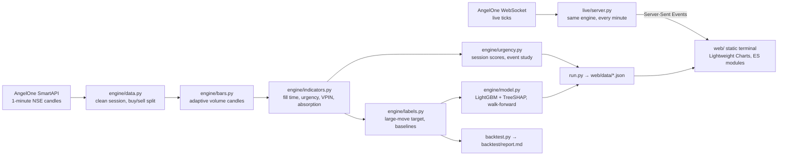

# VolumeLens

**An urgency terminal for NSE stocks.** A time chart gives every five minutes the same space,
whether ten people traded or ten thousand. VolumeLens draws a new candle every time a fixed
number of shares trade, so a burst of urgent volume becomes dozens of candles instead of one.

*Volume-Normalized Market Representation for Quantitative Detection of Price–Flow Anomalies*
Team 53 · Hindustan Institute of Technology & Science



**What the evidence says** (walk-forward on 74 unseen sessions across 11 NSE stocks, [model card](docs/MODEL_CARD.md)):
after an urgent candle, a large move followed **31%** of the time versus **8%** after all other
candles (**3.8×**; **3.3×** outside the opening hour; stable at 3.4–4.1× across thresholds).
Fill pace alone beats VPIN by +0.10 AUC (95% CI +0.07 to +0.13), and the alert model beats VPIN
on all 11 stocks. It ties a well-built time-chart model. Urgency does not predict direction.

## The terminal

| | |
|---|---|
| **Volume candles** | One candle per fixed number of shares, sized per stock from its previous 20 sessions. Amber candles are urgent: the last 3 filled in under 40% of their normal time. |
| **Volume clock made visible** | Time bands shade every other 15/30/60 minutes of clock time: a quiet half hour is a thin band, an urgent one a wide band full of candles, with its candle count. A pace ribbon and ×N marks (one minute that alone filled N candles) are optional. |
| **Chart settings** | Gear or `,`: candle size, colour by direction + urgent / urgency heat / direction, urgency thresholds, clock overlays, normal / log / percent scale, panes. Remembered per browser. |
| **Flow & accumulation** | Net buyer-minus-seller volume over the last 10 volume candles, with a session cumulative delta. Where flow leans one way but price barely moves (absorption), candles are marked accumulation (green) or distribution (red). On by default. |
| **AI analyst** | "Explain this view" or ask a question: the numbers behind the candles in view (urgency, bursts, VPIN, flow, accumulation and distribution zones, alerts) go to Gemini on the server, and a short plain-English read comes back. It describes the data and never advises. |
| **Fill-time strip** | How long each candle took to fill, the normal fill time for that moment, and VPIN. |
| **Compare chart** | A normal 1/3/5/15/30-minute chart for comparison, built in the browser from 1-minute data, with urgent minutes shaded. |
| **Unfold** | Click a time candle: the main chart glides to the volume candles that formed inside it ("the 5-minute candle 15:05–15:10 unfolds into 22 volume candles, 22 urgent"). |
| **Replay** | Plays a session at market pace, so bursts rush in. Only what was known at each moment is shown; this is verified by tests. |
| **Tools** | Horizontal line (on both charts), trend line, zone, measure (Δ price, %, candles, shares, minutes), magnet crosshair, undo, snapshot to PNG, fullscreen. Drawings are saved per stock. |
| **Live** | During market hours a small server on the team's laptop turns AngelOne ticks into the same candles, streamed to every open browser. A LIVE badge shows the last update. Without the server, the site still shows all recorded sessions. |
| **Phone** | The layout adapts to phones: chart first, then the session card, scanner and evidence. |
| **Scanner and alerts** | Stocks ranked by urgency score, the most urgent sessions, and model alerts with TreeSHAP reasons. |
| **Layers** | Compare chart, urgency shading, VPIN and an absorption pane, each on or off. |

Keys: `V` cursor · `H` line · `T` trend · `Z` zone · `M` measure · `G` magnet · `Ctrl+Z` undo ·
`S` snapshot · `F` fullscreen · `R` replay · `Space` play · `←` `→` step · `Esc` back · `?` help.

## Architecture



History is static: all computation runs offline in `run.py`, so hosting needs no server. Live mode is optional: `live/server.py` runs the same engine on today's minutes and streams the result; a test proves it produces exactly the batch output and never changes a published candle.

**Data quality.** AngelOne occasionally reports the day's running total as a minute's volume. `engine/quality.py` detects these runs (for example 15:20–15:29 on 29 Sep 2026, in all 11 stocks) and removes them before any candle is built; every removal is listed in `web/data/index.json`.

```
engine/        data loading, quality gate, volume candles, indicators, labels, model, urgency statistics
live/          live server (AngelOne WebSocket -> engine -> Server-Sent Events)
feed/, fetch.py  AngelOne history download (credentials in config.py, never committed)
web/           the terminal (index.html, css/, js/ modules, fonts/, vendor/, data/)
tests/         engine tests (pytest) and browser tests (tests/e2e, Playwright)
backtest.py    full validation → backtest/report.md, backtest/results.json
docs/          model card, test report, screenshots
```

## Run it

```bash
python -m venv .venv
.venv/Scripts/pip install -r requirements.txt        # Windows; .venv/bin on macOS/Linux
.venv/Scripts/python run.py                          # build web/data from data/*.csv
node dev.js                                          # site + AI analyst on http://127.0.0.1:8777
```

Open <http://127.0.0.1:8777>. The AI analyst needs a Gemini API key in `.env` (git-ignored):
`GEMINI_API_KEY=...` (optional `GEMINI_MODEL`, default `gemini-3.5-flash`). Without it, or with a plain
static server (`python -m http.server 8765 --directory web`), everything else works. For live data during market hours:

```bash
.venv/Scripts/python -m live.server                                   # needs config.py with AngelOne keys
.venv/Scripts/python -m live.server --simulate 2026-09-29 --speed 30  # replay a recorded day through the live path
```

then open <http://127.0.0.1:8777/?live=http://localhost:8787>, or put the server's URL in `web/live.json`. Input is one CSV per stock in `data/`:
`timestamp,open,high,low,close,volume` (1-minute NSE candles).

## Verify it

```bash
.venv/Scripts/python -m pytest -q      # 16 tests: engine, no-repaint, quality gate, live = batch
npm install && npx playwright test     # 64 checks in Edge and Chrome, AI analyst included (Gemini stubbed)
.venv/Scripts/python backtest.py       # walk-forward validation with bootstrap intervals
```

See the [test report](docs/TEST_REPORT.md) for what each check guarantees and the issues it caught.

## Limits

11 large-cap stocks, 85 sessions (June–September 2026), 1-minute data (no order book). Urgency says a
large move is more likely, not which way. The alert model ties a time-chart model built from the
same kind of signals; the volume clock's value is making urgency visible and explainable. Details
and next steps are in the [model card](docs/MODEL_CARD.md).

## Deploy

`vercel.json` serves `web/` as a static site with security headers, plus one function,
`api/analyst.js`, for the AI analyst. Connect the folder or repository in Vercel, no build step, and set
`GEMINI_API_KEY` in Project Settings → Environment Variables (the key never reaches the browser).

## License

Apache License 2.0. See [LICENSE](LICENSE) and [NOTICE](NOTICE) (TradingView Lightweight Charts™,
IBM Plex Sans, JetBrains Mono). Educational project, not investment advice.
